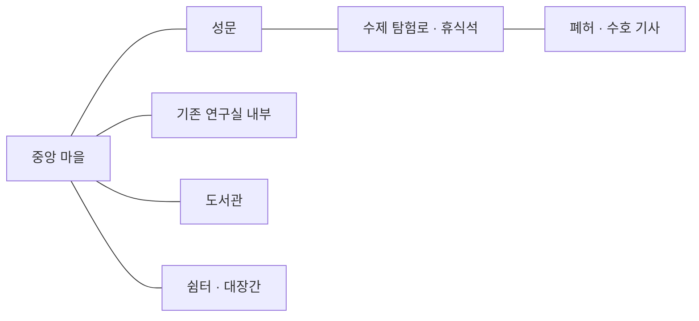

# Phase 3A — 중앙 마을·탐험·수호 기사 구현 및 검증

후속 변경: [밸런스 01](BALANCE_PATCH_01_KO.md)에서 근접 피해·공격 속도와 마나볼트 피해를 하향했다. 아래 실제 창 전체 결과는 Phase 3A 시점 기록이며, 후속 조정의 재검증 범위는 별도 보고서에 구분했다.

작업일: 2026-10-17. 기준은 [사용자 명세 원문](PHASE_3A_SPEC_KO.md)이다. 기존 프로젝트 위에 마을에서 출발해 탐험하고 보스를 격파한 뒤 돌아오는 플레이 경로를 추가했다. 영창 체계·주문·영구 속성 선택 규칙은 바꾸지 않았다. 최종 아트·거대한 월드·제작 시스템·새 대륙 설정은 이번 범위가 아니다.

## 1. 실행과 플레이 경로

1. `project.godot`을 열고 **F5**. 버튼식 로비 대신 중앙 마을에서 시작한다.
2. **RMB**로 이동하고 마우스로 조준한다. **일반 상태 E**로 가까운 시설을 이용한다. **Shift+E는 영창**으로 처리한다.
3. 마을 **북서쪽 연구실 입구 E**로 기존 연구실에 들어간다. Shift 유지→영창→Shift 해제 자동 방출·기록, 초집중의 수동 방출, 관측·일지·시험장·개화·결속 연구는 그대로다. 나가면 같은 입구로 돌아온다.
4. **북동쪽 도서관 E**에서 오행 서적을 읽는다. 기존 `book_<element>` 단서만 기록하며 슬롯을 소비하지 않는다. **남서쪽 쉼터 E**는 회복과 체크포인트다. 남동쪽 대장간은 건물·작업대 상호작용 안내만 제공한다.
5. **동쪽 성문**을 걸어 나가 탐험로를 따라간다. 큰 바위를 우회하고 **여행자 휴식석 E**로 외부 체크포인트를 저장한다.
6. 동쪽 **폐허 입구 E**로 수호 기사에게 도전한다. 첫 격파 시 기록과 **60금**을 저장한다. 같은 길로 돌아와 마을에서 휴식할 수 있다. 재도전 보상은 중복되지 않는다.
7. **F2 → 속성/융합 프리셋 → 월드 보스 → 임시 캐릭터 시작**으로 격리된 보스 시험도 가능하다. 원래 연구실/소형 던전 시험과 WATER_METAL·FIRE_WATER는 유지한다. **시험 종료 · 원래 플레이 복귀**가 원본 복구이며 메뉴 닫기와 다르다.

월드에서도 Shift 이동 시전은 기본 속도 200의 **80%인 160**이다. Shift 두 번은 정지 초집중, LMB는 검/명시적 방출, Ctrl은 기존 물리 회피, Alt는 초월 감각, J는 실제 발견 영창 기록이다. 일반 월드의 던전 번호 선택·L 직접 입장은 사용하지 않는다. 기존 소형 던전은 개발 시험에 남겼다. 휠 또는 `=/−`는 확대 0.65~1.6이다.

## 2. 월드와 카메라

기본 씬은 `scenes/world_main.tscn`이다. 컨트롤러 `scripts/world/world_main.gd`는 기존 `scripts/main.gd`를 상속하여 입력·영창·시뮬레이션·연구실·저장·개발 시험을 재사용한다. 기존 `scenes/main.tscn`과 기존 테스트의 진입점은 유지한다.



월드는 **3840×1920**이며 `scenes/world/town.tscn`, `wilds.tscn`, `ruins.tscn`을 분리했다. 지역 간 메뉴·로딩 없이 같은 좌표계에서 이동하고 연구실 UI만 내부 화면으로 전환한다. 실제 3D/아이소메트릭 좌표는 사용하지 않는다.

Camera2D는 플레이어를 부드럽게 추적하고 월드 경계와 줌을 가진다. 바닥은 정적 청크로 그리고, 건물·나무·플레이어·기사는 Y 정렬 루트에 둔다. 건물의 위에서 본 외곽과 충돌 면적은 일치한다. 나무는 줄기와 충돌하며 위쪽 수관은 자연스럽게 겹친다. 이펙트는 불투명 바닥 뒤에 숨지 않도록 별도 월드 레이어에 그린다. 아트는 Godot 기본 도형이다.

플레이어 경로는 **AStarGrid2D 120×60, 셀 32**와 충돌 검사·가시선 단축을 사용한다. 새 목적지 또는 장애물 변화 시에만 경로를 구한다. 장벽의 위치·반경·보스 경기장 봉쇄 상태가 달라질 때 격자를 갱신하고, 장벽의 남은 시간 변화만으로 갱신하지 않는다. 매 프레임 전체 검색은 없다. 기사도 자신의 몸 반경으로 같은 구조를 사용하며 경로 재요청을 제한한다.

세계관은 동방·서방의 문헌 플레이스홀더만 두었다. 현재 지역의 대륙 소속, 선악, 정치, 전쟁 원인, 주인공 출신은 정하지 않았다.

## 3. 수호 기사 패턴과 반격 기회

보스 데이터는 `data/bosses/ruin_guardian.json`, AI는 `scripts/world/ruin_guardian.gd`다. 고정 원소나 소환수는 없다. 체력은 임시 **260**이다.

| 패턴 | 전조 | 실제 공격 | 1단계 반격 시간 |
|---|---|---|---:|
| 넓은 베기 | 전방 부채꼴 | 전방 반경 135, 피해 22 | 1.55초 |
| 방패 돌진 | 고정된 넓은 직선 | 초당 530 이동, 피해 28, 장애물 충돌 시 중단 | 2.2초, 충돌 시 2.6초 |
| 강한 내려찍기 | 입력 당시 위치의 원형 표식 | 반경 88, 피해 32 | 2.8초 |
| 투척 칼날 | 고정된 사선 | 속도 300의 물리 투사체, 피해 16 | 1.9초 |

전조 중 위치를 따라 무한히 조준하지 않는다. 범위를 벗어나거나 회피해 대응한다. 피해·이동은 충돌을 세분해 처리한다. 체력 절반 이하에서는 공격 순서가 바뀌고 전조가 15% 짧아지며 투척이 **3방향 부채꼴**이 된다. 회복 시간은 10%만 줄여 반격 기회를 남긴다. 자세 붕괴는 2.5초 반격 기회를 제공한다. UI는 보스 체력·단계·패턴·회복 중임을 표시하며 전조와 회복의 색을 구분한다.

긴 영창의 안전을 보장하는 자동 보호막이나 새 고위 마법은 추가하지 않았다. 기존 심화 영창·융합을 사용할 수 있고, 큰 내려찍기 후/돌진 차단/자세 붕괴가 더 긴 입력의 기회다. 실제 사람이 긴 영창을 사용하는 난이도는 수동 조정 대상이다.

## 4. 오행과 물리 특성

기사는 크기 26, 질량 등급 5, 강철 판금과 가연성 관절 내피, 자세 균형 100을 가진다. 별도의 오행 약점표 배율은 없다.

| 오행 | 실제 기회 |
|---|---|
| 木 | 기존 덩굴 속박. 지속은 35%로 줄지만 이동을 막고 전조 진행도 늦추며 자세 압력을 준다. |
| 火 | 충격 피해와 기존 지속 연소. 실제 가연성 내피가 연소를 허용한다. 불활성 재질 시험에서는 연소 강도가 줄어든다. |
| 土 | 기존 무피해 장벽으로 돌진·투사체를 막는다. 돌진 차단 시 노출/반격 시간과 자세 압력이 생긴다. 검 공격을 함께 사용해 격파한다. |
| 金 | 기존 관통 형상이 물리 방패 방어를 더 많이 통과한다. 고정된 金 약점 때문에 피해를 늘리는 구조가 아니다. |
| 水 | 질량·밀기 저항 때문에 기본 135 대신 약 27만 밀지만, 자세 압력·짧은 행동 지연은 남는다. 젖음은 진행 중 연소를 약화한다. |

방어 자세는 일반 충격 피해를 줄이고 관통은 더 많이 통과한다. 공격 뒤 노출 상태에서는 반격 피해가 증가한다. 질량 10 시험에서는 같은 水 입력의 밀기가 약 13.5로 감소한다. 속박·밀기·경직 저항을 적용해도 면역으로 만들지 않았다. 일반 표적의 기존 효과는 바꾸지 않았다.

실제 왕복 검사에서 발견한 결함도 수정했다. 작은 적의 15 반경으로 보스를 밀어 경기장 가장자리에 끼우던 부분을 **적별 충돌 반경**으로 바꿨다. 보스의 직선 추격이 기둥에 막힐 때에는 캐시 경로로 우회한다. 반복 水 밀기 후 몸 전체가 경계 안에 있고 다시 추격하는 회귀 검사를 추가했다.

## 5. 저장·복귀·개발 시험 격리

루트 저장 스키마는 **v4 그대로**다. 선택적인 `world` 확장만 추가하며 그 내부 버전은 1이다.

- 현재 지역·좌표, 마지막 안전 지역·좌표.
- 체력·마나·감각, 사망 횟수.
- 보스 격파 목록, 최초 보상 ID 목록, 진행 중 전투 식별자.
- 알 수 없는 기존 루트/월드 필드는 보존한다. 없는 필드는 기본 마을로 시작한다. 잘못된 형식·위치·미래 버전은 저장 보호 처리한다.

지역 변경·이동 중 6초 간격·시설 출입·휴식·사망·보상·정상 종료에서 기존 트랜잭션 저장을 사용한다. 마을/연구실 출입은 현재 마나와 일지·키 표를 유지한다. 월드 사망은 캐릭터를 삭제하거나 재추첨하지 않고 안전 위치에서 회복시킨다. 보스전 중 종료된 저장은 안전 위치에서 재도전한다. 기존 소형 던전의 부상/유실물 시스템은 변경하지 않았다.

휴식 및 승리 저장 실패는 자원·안전 위치·보상·격파 표시를 롤백한다. 격파 저장 실패는 입구에서 E로 재시도할 수 있다. 보상은 한 번만 지급한다. 최초/보조 개화의 영구 확인과 결속 연구는 여전히 수동이다.

F2 시험은 기존 메모리 저장을 사용한다. 원본 문서·월드 진행·보스 상태·위치·자원·난수·일지·J 상태를 복원한다. 실제 보스전 도중 시험을 열었다 닫아도 공격 상태와 살아 있는 적 참조가 복구되는 것을 검사했다. 에디터 디버그/안전한 명시적 개발 조건과 릴리스 차단 정책은 유지한다. 기본 F5는 시험을 자동 시작하지 않는다.

**실제 사용자 저장은 플레이 테스트에 사용하지 않았다.** 시작/종료 감사는 읽기 전용이다. 확인한 실제 저장은 v4이며 해시는 `c75252f7b021e35a8bf53a6bbd04e080b42b17c8bbb9b822d85f4600ba4b3ac1`이다. [감사 전](.task002_artifacts/phase3a/player_before.log), [감사 후](.task002_artifacts/phase3a/player_after.log). 실제 파일의 마이그레이션이나 덮어쓰기를 수행하지 않았다. v3→v4 원본 백업은 격리 fixture와 에디터 복사 프로젝트에서 검증했다.

## 6. 검증 결과

Godot **4.7.2**, Windows/Compatibility 렌더러에서 검사했다. 단계 순서는 3A-1 자동 18/창 7 → 3A-2 자동 15/창 5 → 3A-3 최초 자동 33/창 20 → 3A-4였다. 이후 경계·질량·재질 회귀를 추가하여 최종 보스 자동 검사는 38개다.

| 구분 | 통과 / 실패 | 내용 |
|---|---:|---|
| 기존 자동 검사·별도 프로세스 재시작 | 817 / 0 | 개인 영창·연구·개화·융합·시각화·저장·UX1·Fusion-UX2 |
| 새 월드 자동 검사 | 90 / 0 | 18+15+38+13+별도 엔진 재시작 6 |
| **자동 합계** | **907 / 0** | 반복 실행은 합계에 중복 계산하지 않음 |
| 기존 실제 창 합성 입력 | 347 / 0 | 기존 303 + Fusion-UX2 44 |
| 새 실제 창 합성 입력 | 48 / 0 | 마을/F2 실제 선택 10, 저장/도서관 5, 보스 효과 20, 완전 왕복 13 |
| **창 합계** | **395 / 0** | 실제 렌더링 창에서 Godot 입력 이벤트 사용 |
| 실제 에디터 메인 씬 실행 경로 | 성공 | 격리 복사 프로젝트에서 F5와 같은 `EditorInterface.play_main_scene()` → 마을 → F2, 명시적 개발 인자 없음 |

자동 검사의 전투 조종기는 최종 마나 상태로 검증한 기초 주문과 기존 전투 실행기를 호출한다. 실제 창의 별도 조종기는 **RMB·Shift·개인 키·LMB·Ctrl 이벤트**를 사용한다. 다섯 속성의 완전 전투와 일반 水 캐릭터의 마을 출발→연구실 실험→탐험→체크포인트→격파→마을 휴식→새 프로세스 복원을 수행했다. 완전 전투에서는 보스 체력·AI 상태를 강제로 고치거나 플레이어를 치료하지 않았다. 패턴별 독립 검사에서는 재현성을 위해 공격 종류와 시작 위치를 지정했다. 둘을 구분한다.

실제 창 전투 조종은 프레임당 0.04초를 진행하는 가속 합성 시나리오다. 사람이 직접 F5 키를 누르거나 손으로 전투한 검사는 아니다. `pilot_seconds`는 판단 루프의 합계이며 실제 플레이 시간으로 해석하지 않는다. 정상 水 캐릭터는 최종 전투에서 피해를 입고도 격파·귀환했으며, 쉼터에서 회복했다.

성능 로그는 `.task002_artifacts/phase3a/phase4_window.log`의 `WINDOW_CPU_PROFILE`이다. 마지막 완전 왕복 전투 검사에서 3,663개 시뮬레이션 프레임의 `_process` 평균은 약 0.165ms, 최대 6.134ms, 마지막 렌더 FPS 모니터는 60이었다(Intel Iris Xe). 렌더 시간 전체를 CPU 측정에 포함한 값은 아니다. 경로/월드 검사는 격자를 매 프레임 재생성하지 않는 것도 검사한다. 측정 FPS는 이 테스트 환경의 순간값이며 다른 기기나 장시간 FPS 보장은 아니다.

**수동 확인 필요:** 실제 손의 회피·영창 조작감, 초집중/긴 심화 영창의 체감 빈틈, 다섯 오행의 난이도 균형, 장시간 플레이, 다른 Godot 4.x/해상도/기기. 실제 배포 릴리스 내보내기는 이번에 수행하지 않았다. 최종 아트·타일맵 편집 도구·청크 스트리밍은 구현하지 않았다.

## 7. 실제 게임 스크린샷

- [마을 시작](.task002_artifacts/phase3a/01_town.png), [기존 연구실](.task002_artifacts/phase3a/02_existing_lab.png), [성문 밖](.task002_artifacts/phase3a/03_gate_exterior.png)
- [도서관](.task002_artifacts/phase3a/05_library.png), [외부 체크포인트](.task002_artifacts/phase3a/06_checkpoint.png)
- [넓은 베기 전조](.task002_artifacts/phase3a/07_warning_SWEEP.png), [돌진 전조](.task002_artifacts/phase3a/07_warning_CHARGE.png), [내려찍기 전조](.task002_artifacts/phase3a/07_warning_SLAM.png), [투척 전조](.task002_artifacts/phase3a/07_warning_THROW.png)
- [木 속박](.task002_artifacts/phase3a/08_boss_WOOD.png), [火 연소](.task002_artifacts/phase3a/08_boss_FIRE.png), [土 차단](.task002_artifacts/phase3a/08_boss_EARTH.png), [金 관통](.task002_artifacts/phase3a/08_boss_METAL.png), [水 밀기](.task002_artifacts/phase3a/08_boss_WATER.png)
- [2단계 부채꼴](.task002_artifacts/phase3a/09_phase2_fan.png), [일반 플레이 격파](.task002_artifacts/phase3a/11_normal_clear.png), [마을 귀환](.task002_artifacts/phase3a/12_returned_town.png), [보존된 J HUD](.task002_artifacts/phase3a/13_preserved_j_hud.png)
- [실제 에디터 실행/F2 화면](.task002_artifacts/phase3a/f5_editor_runtime.png), [에디터 검사 결과](.task002_artifacts/phase3a/f5_editor_result.json)
- [F2의 실제 월드 보스 선택 결과](.task002_artifacts/phase3a/14_world_boss_developer.png)

## 8. 수정 경계와 재현

시작 시 Git 상태와 전체 선행 코드/리소스/테스트/문서 백업을 `.task002_artifacts/phase3a/git_before.txt`, `before_phase3a.zip`에 남겼다. 이 세션의 에이전트 목록에는 현재 에이전트 하나만 있었다. OS의 여러 Codex 프로세스만으로 다른 사용자의 작업 내용까지 확인했다고 주장하지 않는다. 기존 미커밋 작업을 되돌리거나 커밋하지 않았다. 12키/75종 기획은 수정하지 않았다.

새 구현은 `scripts/world/*.gd`, `scenes/world/*.tscn`, `scenes/world_main.tscn`, `data/bosses/ruin_guardian.json`에 있다. 기존 게임 코드 변경은 `project.godot`의 기본 씬·월드 InputMap 추가와 `scripts/elemental_combat.gd`의 적별 명중/충돌 반경 기본값 두 곳이다. 영창 대응·마나 시뮬레이터·개화·결속·주문 리소스·기존 `scripts/main.gd`는 수정하지 않았다.

검사는 `tests/test_world_phase1~4.gd`, `preview_world_phase1~4.gd`, `test_world_restart.gd`, 테스트 전용 `world_battle_policy.gd`를 추가했다. `run_f5_probe.ps1`은 새 기본 씬과 `-WorldMain`을 지원하도록 확장했고, `run_phase3a_regression.ps1`을 추가했다. README·시작 안내·개발 커맨드·GDD에는 새 기본 경로와 이전 씬의 경계를 반영했다.

PowerShell 파일 실행 정책을 바꾸지 않고 다음처럼 로컬 검사 코드를 실행할 수 있다. `$Godot`은 설치된 실행 파일 경로다. 실제 사용자 저장을 쓰지 않는다.

```powershell
& $Godot --headless --path . --script tests/test_world_phase1.gd
& $Godot --headless --path . --script tests/test_world_phase2.gd
& $Godot --headless --path . --script tests/test_world_phase3.gd
& $Godot --headless --path . --script tests/test_world_phase4.gd
& $Godot --path . --script tests/preview_world_phase4.gd
& $Godot --headless --path . --script tests/test_world_restart.gd

$runner = Join-Path (Get-Location).Path 'tests/run_phase3a_regression.ps1'
& ([scriptblock]::Create([IO.File]::ReadAllText($runner))) -ProjectRootOverride (Get-Location).Path
& ([scriptblock]::Create([IO.File]::ReadAllText($runner))) -ProjectRootOverride (Get-Location).Path -Window

$probe = Join-Path (Get-Location).Path 'tests/run_f5_probe.ps1'
& ([scriptblock]::Create([IO.File]::ReadAllText($probe))) -ProjectRootOverride (Get-Location).Path -WorldMain
```

최종 로그는 `.task002_artifacts/phase3a/final_*.log`, `phase4_window.log`, `f5_editor_result.json`이다. 테스트 생성물은 기존 `.task002_artifacts` 제외 규칙 안에만 둔다.
