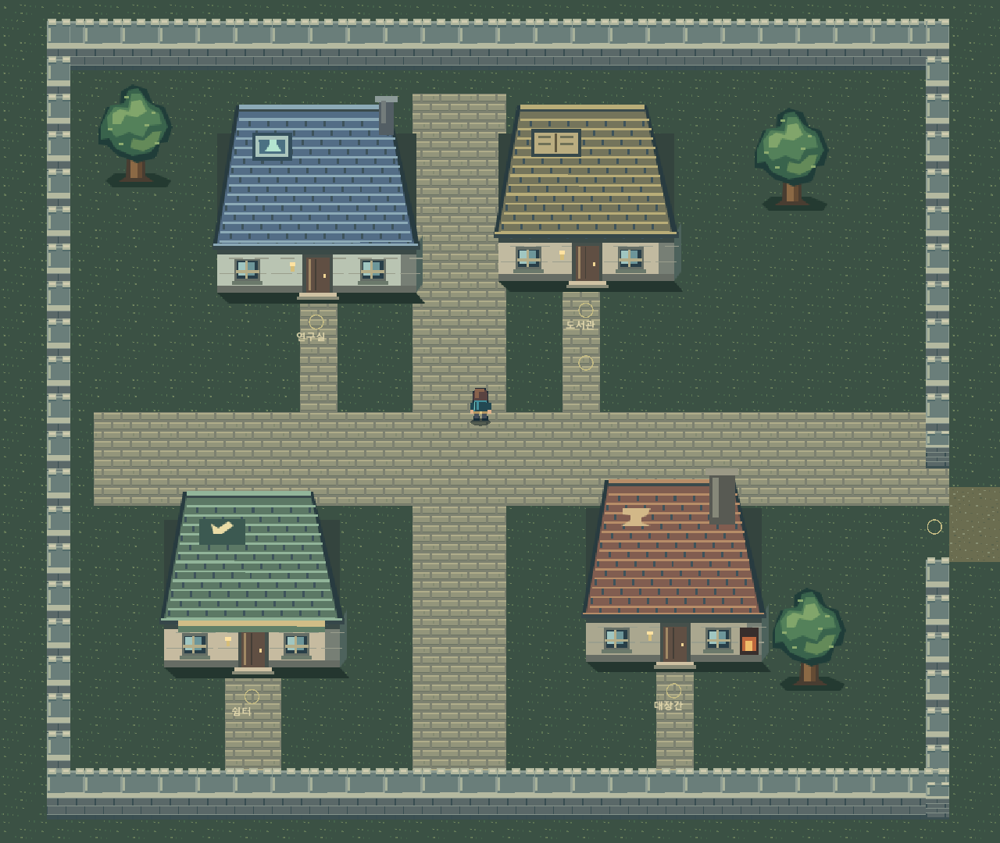
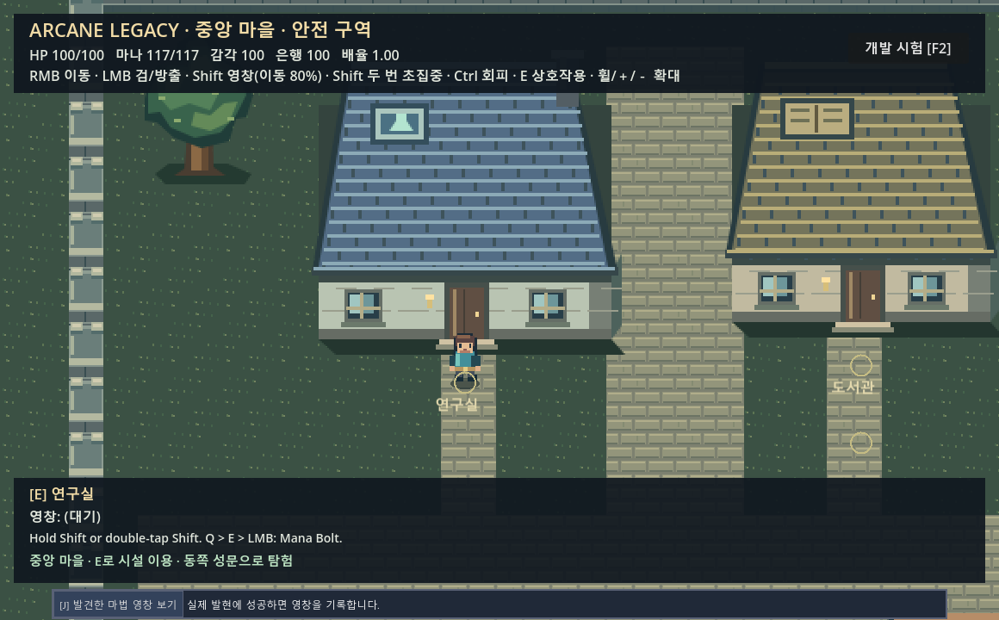
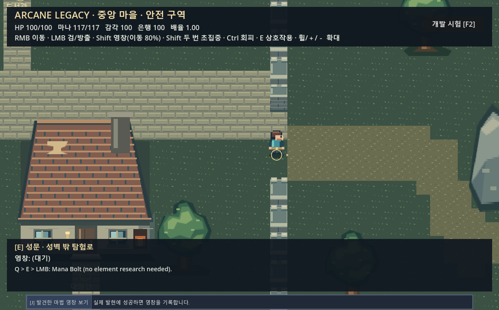
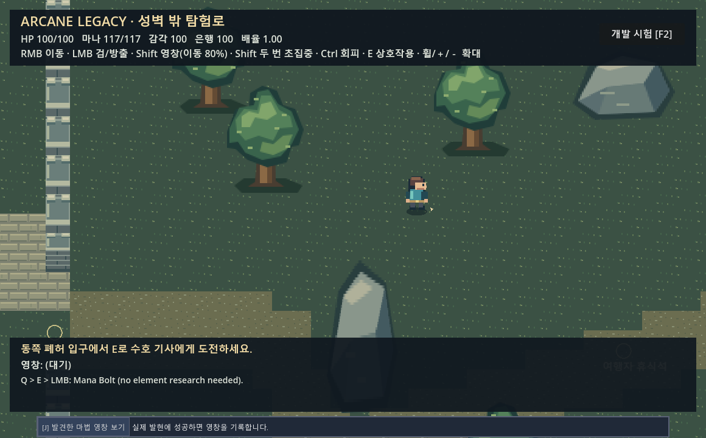
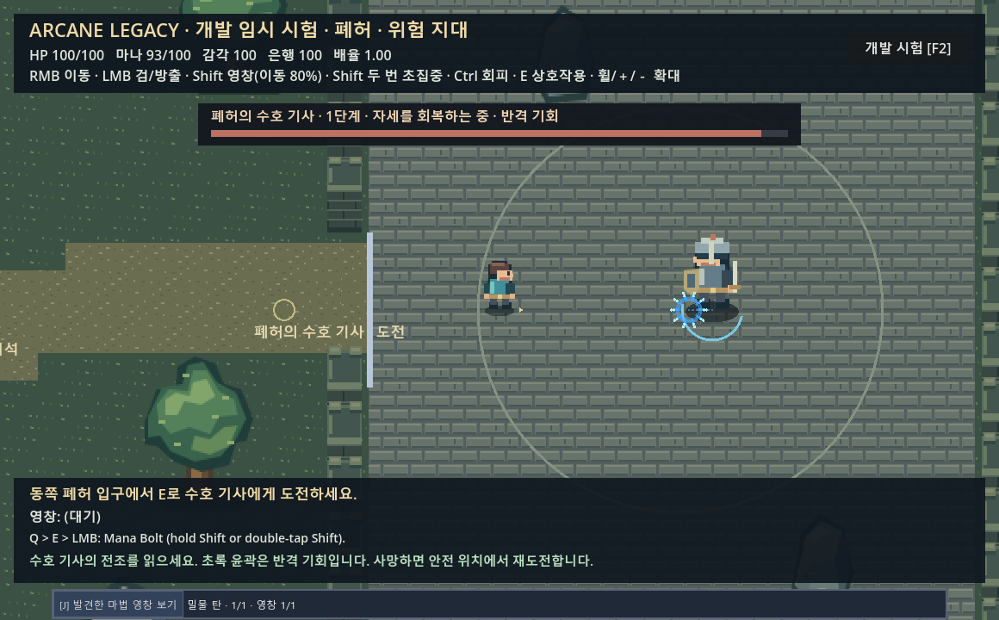

# Phase 3A 시각적 시점 수정 — 2D 탑다운 RPG

검증일: 2026-10-17. 엔진: Godot 4.7.2, Compatibility/OpenGL, Intel Iris Xe.

**구현과 기능 검증을 마쳤으며, 시각적 완성 여부는 사용자 스크린샷 검토 대기다.** Core Keeper와 유사한 공간감을 목표로 했으나 최종 스타일 적합성을 통과로 처리하지 않는다. 사람의 수동 플레이 평가는 미검증이다.

## 구현

바닥은 기존 2D 월드 좌표를 사용한다. 3D 카메라, 좌표 기울임, 아이소메트릭 변환을 추가하지 않았다. 월드 크기·건물 충돌 사각형·나무 충돌 반경·상호작용 좌표·보스 피격 영역도 그대로다.

- 플레이어: 머리·얼굴·몸통·팔·다리·신발이 식별되는 `AnimatedSprite2D`. 아래/왼쪽/오른쪽/위 각각 별도 그림과 보행 자세를 제공한다. 평상시 이동 방향을 보고, 영창·근접공격 중에는 마우스 조준 방향을 본다. 조준 및 시전·회피·초월 감각 표시는 발밑 평면에 유지했다.
- 수호 기사: 같은 발 기준의 별도 갑옷·투구·방패·검 스프라이트. 기존 전조·젖음·반격 기회·2단계 표시와 사망 표현을 유지했다.
- 연구실·도서관·대장간·쉼터: 기와 지붕, 전면 벽, 측면, 창, 문, 문턱, 등불, 그림자, 시설별 표식을 제공한다. 출입문은 기존 E 상호작용 위치의 바로 북쪽에 있다.
- 나무: 층을 이루는 수관, 가지, 줄기와 뿌리, 발밑 그림자. 암석은 밝은 윗면과 어두운 옆면을 갖는다.
- 성벽: 상단 통로·흉벽과 수직 석조 벽면. 긴 벽을 64 월드 단위 구간으로 나누고 중첩 Y-sort를 적용하여 전체 벽의 남쪽 끝 하나로 정렬되지 않게 했다. 기존 성문 틈과 충돌은 유지했다.
- 바닥: 독자적인 잔디·포장·흙길·폐허 타일로 교체하고 시설 출입구에 포장 길을 표시했다. 길은 시각 표현이며 이동 가능 영역을 바꾸지 않는다.

스프라이트와 건물의 정렬 기준점은 **발/바닥 위치**다. 지붕·수관은 북쪽으로 돌출되며 그 부분에 새로운 충돌을 만들지 않는다. 캐릭터가 뒤에 있으면 가려지고 앞에 있으면 몸체가 오브젝트 위에 그려진다.

모든 SVG 14개는 직접 작성한 독자적인 임시 아트다. 타 게임 원본을 복제하거나 외부 유료 에셋을 사용하지 않았다. `tools/generate_world_art.ps1`로 재생성할 수 있으며, 생성된 SVG 자체도 포함되어 실행 시 생성 도구가 필요하지 않다. [에셋 구성·교체 규약](data/world_art/README_KO.md).

## 변경 파일과 보존 범위

| 파일 | 변경 |
|---|---|
| `scripts/world/world_player_view.gd` | 4방향 발 기준 캐릭터와 보행·조준 표현 |
| `scripts/world/guardian_view.gd` | 서 있는 수호 기사와 기존 상태 표시 |
| `scripts/world/world_prop.gd` | 입체감을 가진 시설·나무·성벽·암석, 구간별 정렬 |
| `scripts/world/world_chunk.gd` | 원본 타일을 사용하는 바닥·도로 |
| `scripts/world/world_art.gd` | 텍스처와 SpriteFrames 생성·교체 지점 |
| `data/world_art/`, `tools/generate_world_art.ps1` | 원본 임시 에셋·생성 도구·안내 |
| `tests/test_world_visual.gd`, `tests/preview_world_visual.gd` | 시각 구조 및 실제 렌더링·입력 검사 |
| `tests/run_f5_probe.ps1` | 격리 복사본의 텍스처 임포트가 끝난 뒤 F5 시험 시작 |
| `docs/screenshots/phase3a_visual/` | 편집하지 않은 실제 Godot 캡처 15개 |
| `README.md`, `START_HERE_KO.md`, 이 보고서 | 시각 변경·실행·검증 안내 |

작업 시작 시 기존 `scripts/data/scenes` 파일의 SHA-256을 기록하고 비교했다. 기존 파일 중 변경된 것은 위 표의 **월드 뷰 스크립트 4개뿐**이다. 새 에셋·헬퍼는 별도로 추가했다. `main.gd`, `world_main.gd`, 월드 배치·경로 탐색·수호 기사 AI·마나 시뮬레이터·입력·저장·속성 연구 코드가 시작 시점과 동일함을 확인했다. 감사 기록은 `.task002_artifacts/visual_topdown/source_audit.json`이다. 기존 미커밋 작업을 초기화하거나 덮어쓰지 않았다.

Phase 4 마법 연구·주문 작업은 진행하지 않았다. 개인별 영창·연구·융합·저장 규칙과 전투 밸런스는 이번 작업에서 수정하지 않았다. 실제 사용자 저장을 테스트에 로드하거나 수정하지 않았으며 모든 검사에는 별도 fixture를 사용했다.

## 실제 실행 화면

아래 이미지는 Godot 창의 실제 Viewport를 그대로 저장한 것이다. 합성 이미지나 외부 편집본이 아니다. 전경만 촬영용 1280×1080 창·배율 0.75·HUD 숨김을 사용했다. 나머지 기본 장면은 1160×720, 배율 1.0이다. 연구실 정면은 지붕과 문을 함께 보기 위해 **촬영 중에만** 카메라 offset `(0, -95)`를 적용했다. 일반 플레이의 카메라 설정은 변경하지 않았다. 가림 비교 사진은 UI가 캐릭터를 가리는 오판을 막기 위해 HUD를 숨겼다.

### 1. 마을 전경과 네 시설



### 2. 연구실 정면의 플레이어



### 3. 성벽과 열린 성문 통과



### 4. 나무·암석 사이 이동과 플레이어 옆모습



### 5. 수호 기사 보스전



[전조 표시 화면](docs/screenshots/phase3a_visual/12_guardian_warning.png)도 별도로 저장했다.

### 앞뒤 가림과 방향 비교

| 확인 | 화면 |
|---|---|
| 연구실 뒤: 몸체 가림 / 앞: 몸체 표시 | [뒤](docs/screenshots/phase3a_visual/03_laboratory_behind.png) · [앞](docs/screenshots/phase3a_visual/04_laboratory_in_front.png) |
| 나무 뒤: 수관에 가림 / 앞: 줄기 앞에 표시 | [뒤](docs/screenshots/phase3a_visual/05_tree_behind.png) · [앞](docs/screenshots/phase3a_visual/06_tree_in_front.png) |
| 성벽 뒤: 머리는 보이고 다리는 가림 | [성벽](docs/screenshots/phase3a_visual/07_wall_behind.png) |
| 플레이어 네 방향 | [앞](docs/screenshots/phase3a_visual/10_facing_down.png) · [왼쪽](docs/screenshots/phase3a_visual/10_facing_left.png) · [오른쪽](docs/screenshots/phase3a_visual/10_facing_right.png) · [뒤](docs/screenshots/phase3a_visual/10_facing_up.png) |

## 검증 결과

자동 판정과 실제 창 합성 입력을 구분한다. 실제 창 검사도 자동화된 입력이며 사람의 수동 조작을 대신했다고 주장하지 않는다.

| 방식 | 항목 | 결과 |
|---|---|---|
| Headless | 기존 전투·연구·영창·개화·시각화·UX1·융합 A~D·UX2·월드·보스 회귀 | **901 / 901** |
| Headless | 신규 스프라이트·네 방향·발 기준점·시설/벽 정렬·상호작용 좌표·저장 보존 | **37 / 37** |
| 별도 Headless 프로세스 | 실제 창 완주 저장의 위치·보스 보상·키표·연구 일지·J 즐겨찾기·문서 보존 | **6 / 6** |
| 실제 Godot 창 | 기존 11개 렌더링·GUI·합성 입력 검사 | **347 / 347** |
| 실제 Godot 창 | 신규 시각/가림·연구실 둘레 RMB 이동·성문·나무/암석·4방향·줌·Alt·Ctrl·물 타격·시험 복원 | **36 / 36** |
| 실제 Godot 창 | 기존 월드 Phase1/2/3 검사 | **10 + 5 + 20 / 35** |
| 실제 Godot 창 | 일반 수속성 캐릭터의 연구실→탐험→보스 처치→마을 귀환→저장/씬 재생성 (`--normal-only`) | **8 / 8** |
| 실제 Godot 에디터 | F5와 같은 `EditorInterface.play_main_scene()`→F2·마을·v3 백업/v4 이전·임시 시험 복원 | **통과** |

합계: **Headless 944개, 실제 창 검사 426개, 모두 실패 0개**, 별도 에디터 실행 probe 통과. 마지막 완주 검사에서는 렌더링 모니터 60 FPS를 기록했다. 장시간 성능 보장이나 최종 밸런스 평가를 의미하지 않는다.

가림 검사는 같은 장면에서 캐릭터 표시/숨김 두 프레임의 몸체 영역을 비교했다. UI는 두 프레임 모두 숨겼다. 연구실 뒤와 나무 뒤의 차이는 **0픽셀**, 앞에서는 각각 **1,010픽셀**이었다. 성벽 뒤 다리 영역도 0픽셀이었고 머리가 보이는 화면을 확인했다. 모든 가림 검사 위치는 기존 충돌 영역 밖이다. 연구실 앞→서쪽→뒤→동쪽→정면 경로도 실제 RMB 합성 입력으로 통과했다.

이번에 다섯 속성의 실제 보스 타격·상태·전조·회피는 다시 검사했으나, 각 속성으로 완전 처치하는 장시간 창 검사는 전부 반복하지 않았다. 완전 처치·귀환은 일반 수속성 한 캐릭터로 실행했다. 다른 Godot 버전·다른 GPU·사람의 장시간 플레이 및 **사용자가 원하는 시점에 충분히 가까운지**는 미검증/검토 대기다.

검사 중 발견한 건물 뒤 머리 노출은 지붕 높이를 보완해 해결하고 다시 픽셀 비교했다. 초기 F5 복사본 검사는 텍스처 최초 임포트보다 게임이 먼저 열려 타임아웃이 발생했다. 시험 도구에 사전 임포트를 추가한 후 실제 에디터 검사에서 성공을 확인했다. 실패했던 실행을 통과 수에 포함하지 않았다.

로그·원본 비교·결과 JSON: `.task002_artifacts/visual_topdown/`. 전체 회귀 로그는 그 아래 `regression/`, 새 창 검사는 `window.log`, 자동 검사는 `unit.log`, 별도 재시작은 `world_restart.log`, 에디터 결과는 `f5_editor_result.json`이다.

## 실행 및 재검사

일반 실행은 `project.godot`을 Godot로 열고 임포트를 기다린 뒤 **F5**다. 개발 시험은 게임 화면 **F2**다. 연구실은 북서쪽의 문 앞에서 **E**, 마을 출구는 동쪽 성문이다. RMB 이동·Ctrl 회피·Shift 영창/더블탭 초집중·LMB 공격/방출·Alt·J·휠/`=/−`를 그대로 사용한다.

PowerShell에서 `$Godot`에 console 실행 파일 경로를 지정한 뒤:

```powershell
& $Godot --headless --editor --path . --import --quit
& $Godot --headless --path . --script tests/test_world_visual.gd
& $Godot --path . --script tests/preview_world_visual.gd
& $Godot --path . --script tests/preview_world_phase3.gd
& $Godot --path . --script tests/preview_world_phase4.gd -- --normal-only
& $Godot --headless --path . --script tests/test_world_restart.gd
```

전체 기존 회귀는 `tests/run_phase3a_regression.ps1`(Headless), 같은 도구의 `-Window`(기존 창 검사)로 실행한다. `tests/run_f5_probe.ps1 -WorldMain`은 실제 저장과 별개의 프로젝트를 만들어 에디터 실행 경로를 검사한다. 창 입력 검사는 동시에 여러 개 실행하지 않는다.
